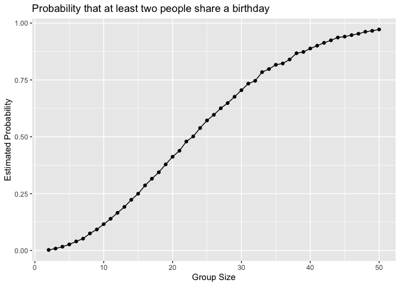
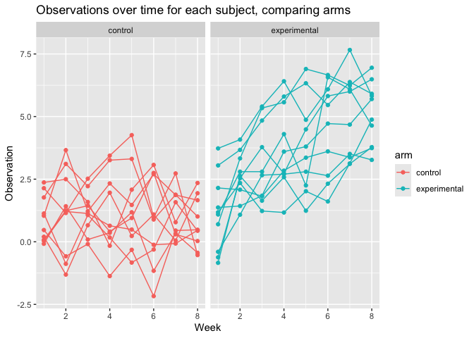
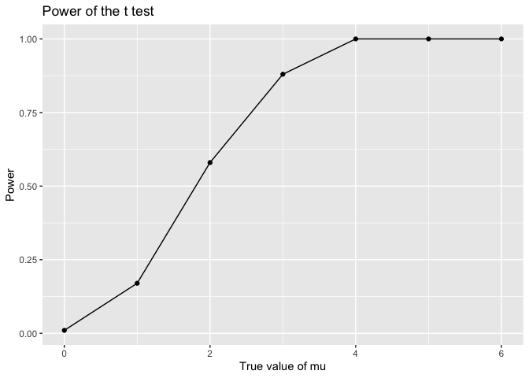
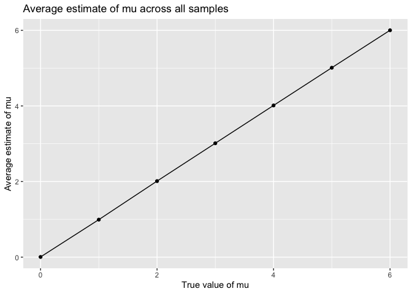
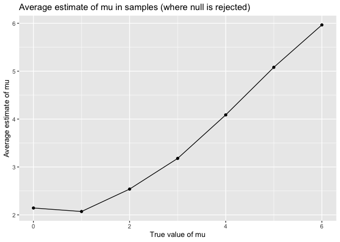

p8105_hw5_mjd2283
================
Max
2026-11-19

``` r
library(tidyverse)
```

    ## ── Attaching core tidyverse packages ──────────────────────── tidyverse 2.0.0 ──
    ## ✔ dplyr     1.2.1     ✔ readr     2.2.0
    ## ✔ forcats   1.0.1     ✔ stringr   1.6.0
    ## ✔ ggplot2   4.0.3     ✔ tibble    3.3.1
    ## ✔ lubridate 1.9.5     ✔ tidyr     1.3.2
    ## ✔ purrr     1.2.2     
    ## ── Conflicts ────────────────────────────────────────── tidyverse_conflicts() ──
    ## ✖ dplyr::filter() masks stats::filter()
    ## ✖ dplyr::lag()    masks stats::lag()
    ## ℹ Use the conflicted package (<http://conflicted.r-lib.org/>) to force all conflicts to become errors

``` r
set.seed(1)

shared_bday = function(n_group) {

  sim_bday = sample(1:365, size = n_group, replace = TRUE)
  any(duplicated(sim_bday))

}

#For any(duplicated()) was unsure where to find in notes so used AI to help find this function. The use is straightforward, if any of the called upon birthdays from the sample() are duplicated.
#Duplicated flags birthdays already included in sample. Any() returns true if a birthday is repeated, false if not. 
```

Assuming no leap years and birthdays are distributed equally

\#creating df

``` r
bday_results_df =
  expand_grid(
    group_size = 2:50,
    iter = 1:10000
  ) |>
  mutate(shared = map(group_size, shared_bday)) |>
  unnest(shared) |>
  group_by(group_size) |>
  summarize(prob_shared = mean(shared))

bday_results_df
```

    ## # A tibble: 49 × 2
    ##    group_size prob_shared
    ##         <int>       <dbl>
    ##  1          2      0.0024
    ##  2          3      0.0085
    ##  3          4      0.0167
    ##  4          5      0.0267
    ##  5          6      0.0399
    ##  6          7      0.0521
    ##  7          8      0.0751
    ##  8          9      0.0925
    ##  9         10      0.116 
    ## 10         11      0.139 
    ## # ℹ 39 more rows

\#plotting

``` r
bday_results_df |>
  ggplot(aes(x = group_size, y = prob_shared)) +
  geom_point() +
  geom_path() +
  labs(
    title = "Probability that at least two people share a birthday",
    x = "Group Size",
    y = "Estimated Probability"
  )
```

<!-- -->

Looking above, we see that as group size increases estimated probability
also increases. The relationship curves upwards, becomes practically
linear, and then levels out as the group size approaches 50

\#problem 2

``` r
study_df =
  tibble(
    files = list.files("data/"),
    path = str_c("data/", files)
  ) |>
  mutate(data = map(path, read_csv)) |>
  unnest(data)

study_df
```

    ## # A tibble: 20 × 10
    ##    files      path       week_1 week_2 week_3 week_4 week_5 week_6 week_7 week_8
    ##    <chr>      <chr>       <dbl>  <dbl>  <dbl>  <dbl>  <dbl>  <dbl>  <dbl>  <dbl>
    ##  1 con_01.csv data/con_…   0.2   -1.31   0.66   1.96   0.23   1.09   0.05   1.94
    ##  2 con_02.csv data/con_…   1.13  -0.88   1.07   0.17  -0.83  -0.31   1.58   0.44
    ##  3 con_03.csv data/con_…   1.77   3.11   2.22   3.26   3.31   0.89   1.88   1.01
    ##  4 con_04.csv data/con_…   1.04   3.66   1.22   2.33   1.47   2.7    1.87   1.66
    ##  5 con_05.csv data/con_…   0.47  -0.58  -0.09  -1.37  -0.32  -2.17   0.45   0.48
    ##  6 con_06.csv data/con_…   2.37   2.5    1.59  -0.16   2.08   3.07   0.78   2.35
    ##  7 con_07.csv data/con_…   0.03   1.21   1.13   0.64   0.49  -0.12  -0.07   0.46
    ##  8 con_08.csv data/con_…  -0.08   1.42   0.09   0.36   1.18  -1.16   0.33  -0.44
    ##  9 con_09.csv data/con_…   0.08   1.24   1.44   0.41   0.95   2.75   0.3    0.03
    ## 10 con_10.csv data/con_…   2.14   1.15   2.52   3.44   4.26   0.97   2.73  -0.53
    ## 11 exp_01.csv data/exp_…   3.05   3.67   4.84   5.8    6.33   5.46   6.38   5.91
    ## 12 exp_02.csv data/exp_…  -0.84   2.63   1.64   2.58   1.24   2.32   3.11   3.78
    ## 13 exp_03.csv data/exp_…   2.15   2.08   1.82   2.84   3.36   3.61   3.37   3.74
    ## 14 exp_04.csv data/exp_…  -0.62   2.54   3.78   2.73   4.49   5.82   6      6.49
    ## 15 exp_05.csv data/exp_…   0.7    3.33   5.34   5.57   6.9    6.66   6.24   6.95
    ## 16 exp_06.csv data/exp_…   3.73   4.08   5.4    6.41   4.87   6.09   7.66   5.83
    ## 17 exp_07.csv data/exp_…   1.18   2.35   1.23   1.17   2.02   1.61   3.13   4.88
    ## 18 exp_08.csv data/exp_…   1.37   1.43   1.84   3.6    3.8    4.72   4.68   5.7 
    ## 19 exp_09.csv data/exp_…  -0.4    1.08   2.66   2.7    2.8    2.64   3.51   3.27
    ## 20 exp_10.csv data/exp_…   1.09   2.8    2.8    4.3    2.25   6.57   6.09   4.64

\#tidying up the data

``` r
tidy_df = 
  study_df |>
  mutate(
    subject = str_replace(files, ".csv", ""),
    arm = str_sub(subject, 1, 3),
    arm = recode_values(arm, "con" ~ "control", "exp" ~ "experimental")) |>
  pivot_longer(
    week_1:week_8,
    names_to = "week",
    values_to = "observation",
    names_prefix = "week_") |>
  mutate(week = as.numeric(week)) |>
  select(subject, arm, week, observation)

tidy_df
```

    ## # A tibble: 160 × 4
    ##    subject arm      week observation
    ##    <chr>   <chr>   <dbl>       <dbl>
    ##  1 con_01  control     1        0.2 
    ##  2 con_01  control     2       -1.31
    ##  3 con_01  control     3        0.66
    ##  4 con_01  control     4        1.96
    ##  5 con_01  control     5        0.23
    ##  6 con_01  control     6        1.09
    ##  7 con_01  control     7        0.05
    ##  8 con_01  control     8        1.94
    ##  9 con_02  control     1        1.13
    ## 10 con_02  control     2       -0.88
    ## # ℹ 150 more rows

``` r
#R gave me a warning so I switched case_match() to recode_values()

#replaced the name using mutate and then used case match to make con -> control and exp -> experimental
```

``` r
tidy_df |>
  ggplot(aes(x = week, y = observation, group = subject, color = arm)) +
  geom_point() +
  geom_path() +
  facet_grid(~arm) +
  labs(
    title = "Observations over time for each subject, comparing arms",
    x = "Week",
    y = "Observation"
  )
```

<!-- -->
Looking above, we see that the observations fluctuate a bit for the
control group but stay mainly around -1.25 and 2.75 (with some outliers)
and has no clear increase or decrease. In comparison, the experimental
group started out with observations around this range but they got
increasingly larger.

\#problem 3

``` r
sim_t_test = function(mu, n = 30, sigma = 5) {

  sim_data = tibble(
    x = rnorm(n, mean = mu, sd = sigma)
  )
  
  sim_data |>
    pull(x) |>
    t.test(mu = 0) |>
    broom::tidy() |>
    select(estimate, p.value)
}

#created input data, and then made x to do t.test on
#used AI assistance to know how to perform t.test(mu=0), mu=0 is the null in this case
#Also used AI to select the values estimate and p value
```

``` r
sim_results_df =
  expand_grid(
    true_mu = 0:6,
    iter = 1:5000
  ) |>
  mutate(estimate_df = map(true_mu, sim_t_test)) |>
  unnest(estimate_df)

#used expand_grid to make the new row values, used map() to perform sim_t_test on mu values, and then used unnest() to get estimate and p value
```

\#plots

``` r
power_df =
  sim_results_df |>
  group_by(true_mu) |>
  summarize(power = mean(p.value < 0.05))

#looking at the mean of true vs false (so will get proportion)
#used AI assistance to help with approach here, also confirmed with lecture notes 

power_df |>
  ggplot(aes(x = true_mu, y = power)) +
  geom_point() +
  geom_path() +
  labs(
    title = "Power of the t test",
    x = "True value of mu",
    y = "Power"
  )
```

<!-- --> As
mu increases, the power rapidly increases and levels out around mu = 4.

\#average estimate of mu

``` r
avg_df =
  sim_results_df |>
  group_by(true_mu) |>
  summarize(avg_mu_est = mean(estimate))

avg_df |>
  ggplot(aes(x = true_mu, y = avg_mu_est)) +
  geom_point() +
  geom_path() +
  labs(
    title = "Average estimate of mu across all samples",
    x = "True value of mu",
    y = "Average estimate of mu"
  )
```

<!-- -->

``` r
avg_est_rejected_df =
  sim_results_df |>
  filter(p.value < 0.05) |>
  group_by(true_mu) |>
  summarize(avg_mu_rej_est = mean(estimate))

avg_est_rejected_df |>
  ggplot(aes(x = true_mu, y = avg_mu_rej_est)) +
  geom_point() +
  geom_path() +
  labs(
    title = "Average estimate of mu in samples (where null is rejected)",
    x = "True value of mu",
    y = "Average estimate of mu"
  )
```

<!-- -->

Looking above, we see that the average estimate of mu in all samples is
approximately equal to the true value of mu. In comparison, when looking
at the average estimate of mu for samples where the null is rejected,
this value is not equal to the true value of mu (particularly earlier on
where there is more bumps in the graph). After mu equals 4 and onwards,
the relationship looks more diagonal showing its more equivalent to the
true value of mu.
